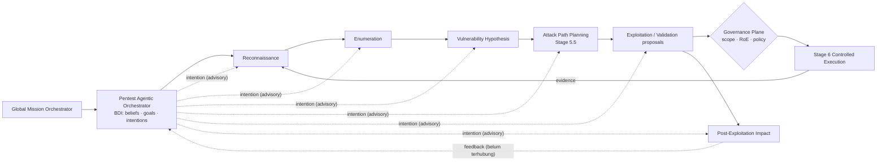

# APTS Pentest Subsystem — Arsitektur Agent (Non-LLM Agentic AI, bounded autonomy)

Status: **Fase 1** (P1 + P8), **Fase 2** (P2 + P5) dan **Fase 3** (P3 lapisan statistik + P4 penjelasan planner) **Fase 4** (P6 pembelajaran + P7 belief store & memori episodik) dan **sisa pekerjaan** (§13: ingest otomatis, pelatihan classifier terjaga, enrichment CPE/ATT&CK, studi ablasi) terimplementasi.
Acuan: *Analisis Perbaikan APTS Pentest Subsystem menuju Non-LLM Agentic AI* (17 Nov 2026).

## 1. Definisi kerja

> **Non-LLM Agentic AI** adalah sistem agen yang secara mandiri mempersepsi lingkungan, mempertahankan *beliefs* dan *goals*, memilih serta merencanakan aksi untuk mencapai tujuan, beradaptasi terhadap hasil aksinya, dan berkoordinasi dengan agen lain. Penalarannya non-LLM (simbolik, planning, probabilistik, statistik/ML ringan), dan otonominya dibatasi kebijakan tata kelola yang eksplisit.

Klaim setelah Fase 1: *goal-directed multi-agent system*. Setelah Fase 2: *Agentic (bounded autonomy), symbolic* — dengan catatan pada §8 (runtime terpasang; lihat §8–9); "Neuro-Symbolic" menunggu Fase 3; "adaptif" menunggu Fase 4.

## 2. Registry agent

Kolom **Tipe target** adalah *target arsitektur*. Kolom **Mekanisme terimplementasi** adalah yang benar-benar ada di kode saat ini.

| ID | Agent | Tipe target | Mekanisme terimplementasi | Otoritas | File |
|---|---|---|---|---|---|
| PEN-A01 | Pentest Agentic Orchestrator | BDI (deliberatif) | **Fase 1:** belief projection, 3 goal dengan satisfaction condition, capability schema (precondition/effect), siklus deliberasi berbasis utilitas, intention tercatat. Task graph DAG + 4 aksi replan (5.1) | Koordinasi & proposal saja; tidak mengeksekusi | `orchestration/orchestrator.py`, `orchestration/deliberation.py`, `orchestration/deliberation_store.py` |
| PEN-A02 | Reconnaissance | RAO | Normalisasi & agregasi deterministik + **Fase 2:** loop event-driven, pemilihan teknik berbasis information gain, stopping rule (`orchestration/perception_action.py`) | Proposal ke Stage 6 | `reconnaissance.py` |
| PEN-A03 | Enumeration | RAO | Model aset berbasis bukti + **Fase 2:** loop yang sama (6 teknik terkatalog) | Proposal ke Stage 6 | `enumeration.py` |
| PEN-A04 | Vulnerability Hypothesis | Neuro-Symbolic (target) | Simbolik: `fnmatch` + `min(knowledge, evidence)` (gerbang, tidak diubah). **Fase 3:** skor statistik non-LLM di belakang gerbang (`hypothesis_scoring.py`: TF-IDF char n-gram + regresi logistik, berversi/berhash). **Bobot saat ini prior, belum terlatih** → label neuro-symbolic belum dibenarkan sampai `fit()` dengan hasil validasi nyata | Hipotesis, bukan eksploitabilitas | `vulnerability_hypothesis.py` |
| PEN-A05 | Attack Path Planning | Graph planner | Stage 5.5: skor `0.8·confidence + 0.2·impact` + sort. **Planner sebenarnya** di lapisan workspace: STRIPS uniform-cost + action masking (`symbolic_planner.py`, otonom, berversi). **Fase 3:** penjelasan per path (`plan_explanation.py`) | Path usulan, bukan path eksekusi | `attack_path_planning.py` |
| PEN-A06 | Exploitation (validation) | Hybrid Reactive-Deliberative (target) | Proposal + deskriptor validasi; **Fase 2:** lapisan reaktif resmi (`TARGET_CONDITION_DEGRADE`, validasi inconclusive → strategi lebih rendah risiko) + arbitrasi R1–R3 (`orchestration/reactive.py`) | Tanpa eksekusi di Stage 5 | `exploitation.py`, `adaptive_reproposal.py` |
| PEN-A07 | Post-Exploitation Impact | Hybrid Reactive-Deliberative (target) | Agregasi level dampak; umpan balik goal baru ke Orchestrator belum ada (Fase 2) | Analisis, severity ditunda ke Stage 6 | `post_exploitation_impact.py`, `cross_agent_feedback.py` |
| PEN-D01 | Reporting & Remediation | Data Artifact | Artefak lineage/evidence/finding | Tanpa otoritas | `lineage_*` |
| PEN-X01 | Stage 6 Controlled Execution | Service | Satu-satunya pelaksana aksi | Eksekusi (read-only, loopback, fail-closed) | `exploitation_execution.py` |

## 3. Model BDI Orchestrator (Fase 1)

**Beliefs** (`project_beliefs`): dari task graph (capability `SUCCEEDED`) dan counter hasil pengamatan: `in_scope_assets`, `enumerated_assets`, `open_hypotheses`, `candidate_paths`, `validated_paths`, `rejected_paths`, `proposed_paths`, `impact_assessed_paths`, `budget_remaining`, `blocked_capabilities`. Input tidak valid ditolak (fail-closed).

**Goals** (prioritas) dan kondisi tercapai:

| Goal | Prio | Satisfaction condition |
|---|---|---|
| `COVER_IN_SCOPE_ASSETS` | 1.0 | `in_scope_assets > 0` dan `enumerated_assets >= in_scope_assets` |
| `RESOLVE_OPEN_HYPOTHESES` | 0.8 | COVER tercapai, `vulnerability_analysis` selesai, `open_hypotheses == 0`, tidak ada path kandidat yang belum divalidasi |
| `ASSESS_IMPACT_OF_VALIDATED_PATHS` | 0.6 | COVER tercapai, `impact_assessed_paths >= validated_paths`, dan setiap path tervalidasi punya proposal |

**Capability schema** (operator planning): tiap kapabilitas punya precondition, effect, dan goal yang dilayani (`CAPABILITY_SCHEMA`).

**Siklus deliberasi** (`deliberate`): hitung goal → bangkitkan opsi yang precondition-nya terpenuhi dan goalnya belum tercapai → utilitas `prio − 0.3·biaya − 0.3·risiko − penalti_governance` → intention = utilitas tertinggi (tie-break: urutan `CAPABILITY_SEQUENCE`). Berhenti dengan status `GOALS_SATISFIED`, `BUDGET_EXHAUSTED`, atau `NO_FEASIBLE_OPTION`. Kapabilitas yang diblokir governance (`blocked_capabilities`) tidak pernah dipilih.

**Persistensi** (sidecar migration `018_phase1_bdi_deliberation.sql`, append-only dengan trigger, berhash SHA-256): `pentest_deliberation_records` (beliefs, opsi, skor, alasan), `pentest_agent_goals`, `pentest_agent_intentions`. Cycle yang sama dengan beliefs/intention identik di-*replay*, bukan diduplikasi.

**`CAPABILITY_SEQUENCE` tetap ada** sebagai urutan default dan penegak dependensi pada task graph 5.1 (kontrak 5.1 tidak diubah). Setiap intention membawa `dispatch_mode`: `DEFAULT_SEQUENCE_COMPATIBLE` bila node sudah `READY`, atau `REQUIRES_PLAN_REORDER` bila intention melompati urutan default (`skipped_default_capabilities`). Pelonggaran dependensi graph untuk dispatch out-of-sequence adalah pekerjaan Fase 2; saat ini deliberasi bersifat *advisory* dan tidak memutasi graph.

## 4. Tingkat otonomi (bounded autonomy)

| Level | Arti | Kapabilitas saat ini |
|---|---|---|
| L0 | Hanya saran | — |
| L1 | Proposal otomatis | reconnaissance, enumeration, vulnerability_analysis, attack_path_analysis, impact_analysis |
| L2 | Proposal butuh persetujuan kebijakan | validation, exploitation (dikenai penalti utilitas dan flag `requires_policy_approval`) |
| L3 | Persetujuan manusia | eskalasi (`ESCALATE`) |

Tidak ada level yang memberi Orchestrator otoritas eksekusi: otonomi bertambah pada *keputusan apa yang diusulkan*, bukan pada *otoritas menjalankan*. Pembatasan oleh Governance Plane adalah desain, bukan kekurangan agensi.

## 4b. Fase 2

**P2 — loop persepsi–keputusan–aksi** (`orchestration/perception_action.py`, fungsi murni state-in/state-out):
- *Persepsi*: event `STAGE6_EVIDENCE_SEALED` memperbarui permukaan yang belum diketahui (hanya bisa berkurang). Event yang sama diputar ulang = no-op (idempoten).
- *Keputusan*: dari allowlist server/RoE ∩ katalog teknik, skor = `gain − 0.05·biaya − 0.05·noise`, `gain = yield × sisa/total` pada dimensi yang disasar. Teknik di luar allowlist atau di daftar terlarang tidak pernah dipilih; teknik yang dua kali berturut-turut tanpa temuan baru dikeluarkan.
- *Stopping rule*: `COVERAGE_REACHED` (≥0,95), `MARGINAL_GAIN_BELOW_THRESHOLD` (<0,05), `NO_ALLOWED_TECHNIQUE`, `BUDGET_EXHAUSTED`.
- *Aksi*: hanya **proposal** ke Stage 6. Penurunan intensitas (`max_noise`) bersifat tighten-only.
- Arti "RAO" yang dipakai: *Reactive* (dipicu event sealed), *Autonomous* (memilih teknik sendiri dalam allowlist), *Opportunistic* (memprioritaskan dimensi dengan gain tertinggi) — dipetakan ke `on_evidence_sealed`, `decide`, dan skor gain.

**P5 — lapisan reaktif & arbitrasi** (`orchestration/reactive.py`):
- `TARGET_CONDITION_DEGRADE` kini resmi di `CROSS_AGENT_FEEDBACK_TYPES`; pada subjek reconnaissance/enumeration ia memicu `REPLAN_LOCAL` (restart kapabilitas yang diprobe), pada subjek lain `NO_CHANGE`. Hash kontrak 5.8 berubah (dihitung, bukan di-hardcode); gate 5.8–5.10 lulus.
- Lapisan deliberatif: `select_validation_strategy` (PASSIVE → NON_DESTRUCTIVE → CONTROLLED; dibatasi RoE, aset CRITICAL selalu PASSIVE). Reaktif: `react_to_inconclusive_validation` hanya turun risiko, selain itu `DEFER_TO_STAGE6`.
- Arbitrasi: **R1** halt/eskalasi menekan intention; **R2** degradasi menggantikan intention dengan re-proposal lebih lembut (rate_cost/concurrency ≤ 1, kalau tidak ditolak); **R3** tanpa kondisi buruk, intention deliberatif berlaku. Preemption dicatat pada record berhash.

## 5. Alur (koreksi diagram)

Perubahan dari diagram lama: label "CTI Subsystem Orchestrator" → **Pentest Agentic Orchestrator**; tahap **Attack Path Planning (Stage 5.5)** ditambahkan; panah umpan balik Post-Exploitation → Orchestrator ditampilkan (putus-putus karena baru terhubung di Fase 2).

## 6. Pengujian

Fase 2: `tests/test_phase2_perception_reactive.py` (20 tes: seleksi berbasis gain, allowlist, stopping rule, loop event-driven + replay, reactive preemption, arbitrasi, invarian governance, jalur feedback→local replan nyata).

Fase 1

`tests/test_phase1_bdi_deliberation.py` — membuktikan: (1) *non-fixed plan*: bukti berbeda → urutan intention berbeda; (2) *goal satisfaction*: berhenti saat goal tercapai, bukan saat urutan habis; budget habis menghentikan loop; (3) governance block tidak pernah dipilih; (4) record berhash, append-only, replay idempoten; (5) kontrak 5.1 tidak berubah dan graph tidak dimutasi.

Menjalankan: dari `mission_orchestrator/`, `python -m pytest tests/test_phase1_bdi_deliberation.py`.

## 7. Batasan yang diketahui (lihat juga §9)

- Observasi (counter beliefs) disuplai pemanggil; belum ada proyeksi otomatis dari shared state/event store (Fase 2).
- Belum ada endpoint HTTP/UI untuk deliberasi; akses lewat `DeliberativeOrchestratorRepository.run_deliberation_cycle`.
- Bobot utilitas statis dan berversi (`bdi-utility-policy-v1`); pembelajaran bobot adalah Fase 4.

## 8. Pemasangan ke runtime (Fase 2)

Launcher `run/pentest_subsystem.py` kini memakai `serve_runtime_autonomy` (`runtime_autonomy_api.py`), handler turunan Stage 5.10 yang **menambah** rute tanpa mengubah rute lama (dispatch tetap ditolak 409).

| Rute | Fungsi |
|---|---|
| `GET /api/contracts/runtime-autonomy` | kontrak ringkas (otoritas eksekusi = Stage 6, ticker default OFF) |
| `GET /api/pentest/agentic-orchestrations/{id}/autonomy` | deliberasi terakhir, keputusan persepsi terakhir per kapabilitas, arbitrasi, `integrity_verified` |
| `POST .../autonomy/deliberate` `{budget_remaining?, blocked_capabilities?}` | siklus BDI atas **beliefs yang diproyeksikan dari stage run tersimpan** (bukan input pemanggil) |
| `POST .../autonomy/tick` `{auto_iterate?, budget?}` | satu putaran loop P2 + arbitrasi P5 |

Alur `tick` (`orchestration/runtime_autonomy.py`): (1) proyeksi coverage dari run Recon/Enumeration terbaru; (2) baca hasil Stage 6 **read-only** lewat provider loopback yang sudah ada — hanya hasil terminal `SUCCEEDED` dengan evidence `SEALED` menjadi event `sealed-<sha>`; (3) event baru → `on_evidence_sealed`, keputusan ditulis append-only (`pentest_perception_decisions`, migrasi 019); (4) bila hasil membawa sinyal kondisi target buruk → `max_noise=0` (tighten-only) dan arbitrasi R2/R1; selain itu R3, dicatat di `pentest_arbitration_records`; (5) event yang sama tidak diproses ulang.

- `auto_iterate=true` (hanya Recon) memanggil `run_reconnaissance_iteration` yang sudah ada dan tervalidasi (reassessment, tanpa I/O target); default **false**.
- Ticker latar belakang **opt-in**: set `APTS_AUTONOMY_TICK_SECONDS` (≥5) sebelum menjalankan server; ia hanya `tick` dengan `auto_iterate=false`. Default mati.
- Allowlist teknik mengikuti semantik RoE yang sudah ada (`allowed_techniques_for`): action class `TARGET_RECON` wajib diizinkan dan tidak dilarang; `allowed_techniques` eksplisit selalu menang; tanpa daftar eksplisit hanya `PASSIVE_DISCOVERY` (Recon) dan teknik enumeration terkatalog yang tersirat, sedangkan `TCP_CONNECT_SCAN` aktif wajib eksplisit. Selain itu loop berhenti `NO_ALLOWED_TECHNIQUE` (fail-closed). Permukaan kosong berhenti `NO_SURFACE_OBSERVED`, bukan `COVERAGE_REACHED`.
- Server perlu **restart** (port 8790) agar rute baru aktif; tabel sidecar 018/019 dibuat saat pemanggilan pertama.
- Nama `get_stage6_execution_results` di service aktif ditimpa (shadow) oleh Enumeration; runtime memanggil versi kelas pemilik secara eksplisit.

Pengujian: `tests/test_phase2_runtime_autonomy.py` (10 tes: proyeksi, idempotensi, event sealed, auto-iterate, preemption, append-only, HTTP, ticker).

## 9. Batasan

- **Proposal belum otomatis dikirim ke Stage 6.** Keputusan loop (teknik berikutnya) tersimpan dan terbaca lewat GET; membuat Action Request baru tetap lewat jalur Recon/Enumeration yang ada.
- Enumeration: hasil Stage 6 dibaca hanya bila `execution_result_provider` terkonfigurasi (perilaku existing); iterasi enumeration berupa proyeksi read-only sehingga coverage berubah hanya setelah run enumeration baru.
- Proyeksi beliefs adalah pemetaan kasar atas artefak stage (mis. `validated_paths` = jumlah validation task, `impact_assessed_paths` = itu bila run 5.7 ada). Ambang dan koefisien belum dikalibrasi.
- Sinyal kondisi target dibaca dari `condition_signal` pada hasil Stage 6 bila ada; bila Stage 6 tidak menyertakannya di ExecutionResult, lapisan reaktif tidak aktif (belum diverifikasi pada Stage 6 hidup).
- Umpan balik Post-Exploitation → Orchestrator (`ASSESS_LATERAL_REACH`) belum ada.
- Suite Stage 6.9/6.10 sudah gagal sebelum perubahan (62 kegagalan identik dengan/tanpa bump enum), sehingga dampak ke gate 6.x tidak dapat diverifikasi.

## 10. Uji server hidup (17 Nov 2026)

Dijalankan pada instance terpisah (port 8899) dengan **salinan** DB live (`APTS_PENTEST_DB`); DB live tidak disentuh (tidak ada tabel sidecar di sana). Pada orchestration WPT nyata (hipotesis 19, belum ada attack path):
- `deliberate` → intention `attack_path_analysis` (`DEFAULT_SEQUENCE_COMPATIBLE`); COVER dan ASSESS tercapai, RESOLVE belum.
- `tick` (2×, idempoten) → baseline persepsi; enumeration mengusulkan `CONFIGURATION_OBSERVATION`/`VERSION_DISCOVERY`, recon `PASSIVE_DISCOVERY`; `integrity_verified=true`; semua flag eksekusi/otorisasi/I/O `false`; `/api/execution/dispatches` tetap 409.
- Dua bug ditemukan hanya oleh data nyata dan sudah diperbaiki: proyeksi terlalu berorientasi host (misi web punya aset enumerasi tanpa host recon) dan permukaan kosong dianggap "tercakup".
- Belum teruji hidup: event sealed nyata dari Stage 6 (misi ini belum punya action request), `auto_iterate`, dan sinyal kondisi target.

## 11. Fase 3 (P3 + P4)

**Koreksi terhadap dokumen acuan (P4):** planner tidak perlu dibangun dari nol. `symbolic_planner.py` (STRIPS monoton, uniform-cost, action masking, precondition/effect, backward-relevance, fallback PPO opsional) sudah ada, terpasang di `attack_path_workspace` dan berjalan otonom dengan revisi sealed. Dokumen menilai dari run Stage 5.5 saja. Yang kurang adalah **penjelasan** dan **struktur kausal**:

- `plan_explanation.py` (`GET .../autonomy/plan-explanation`): per path → rantai precondition (dipenuhi oleh fakta awal atau langkah mana), rincian biaya (`cost + 0.25·impact + (1−confidence)`), alasan terpilih, alternatif yang ditolak beserta selisih biaya, aksi yang ditahan (`CONFLICTING`), tujuan tak terjangkau, dan **diagnosis struktur**.
- Diagnosis pada data live: `VALIDATION_PRIORITISATION_ONLY` — 19 aksi semuanya `VALIDATION_ONLY`, tanpa edge kausal selain "aset teramati". Jadi rencana saat ini adalah pemeringkatan prioritas validasi, **bukan rantai serangan**. Rantai multi-langkah butuh kontrak `planning_model` dari CTI atau edge teknik ATT&CK; itu belum ada dan **belum dikerjakan** (butuh pemetaan CVE→CWE→CAPEC→ATT&CK dari Vulndesk). A*/HTN tidak ditambahkan: tanpa struktur kausal heuristik tidak memberi manfaat nyata atas uniform-cost.

**P3 — lapisan statistik** (`hypothesis_scoring.py`, `POST|GET .../autonomy/hypothesis-scores`, migrasi 020 append-only):
- Gerbang simbolik tidak berubah; skor hanya untuk hipotesis yang sudah lolos, tidak mengubah field hipotesis maupun `confidence.overall`.
- Similarity TF-IDF char 3-gram (`similarity`, `best_matches`) untuk nama produk ambigu; 7 fitur → regresi logistik; `advisory_rank_score = 0,5·simbolik + 0,5·statistik` (koefisien blend adalah pilihan awal).
- Record membawa `model_version`, `weights_sha256`, vektor fitur → replay deterministik per versi model. Model dimiliki server (POST tidak menerima model dari pemanggil).
- `fit()` deterministik, menolak < 30 sampel atau satu kelas. **Tidak ada data berlabel hasil validasi saat ini**, jadi model yang berjalan adalah `PRIOR_UNTRAINED` (bobot tangan, bukan hasil belajar) dan label keluaran eksplisit `NEURO_SYMBOLIC_NOT_JUSTIFIED_PRIOR_MODEL`. Catalog CPE dictionary dari Vulndesk belum disambungkan ke `best_matches` (fungsi siap, katalog belum dialirkan).
- Uji hidup (salinan DB): 19 hipotesis, skor statistik hampir seragam (~0,47) karena semuanya cocok hanya pada dimensi *technology* (`dims_count=1`); bobot prior belum membedakan. Diskriminasi baru bermakna setelah ada versi/CPE match atau model terlatih.
- EPSS/KEV tidak dipakai (tidak tersedia di data pentest saat ini).

Pengujian: `tests/test_phase3_scoring_and_explanation.py` (12 tes).

## 12. Fase 4 (P6 + P7)

**Sumber label nyata.** Hasil kontrol Stage 6 (`pentest_exploitation_execution_runs`, diverifikasi dengan `verify_execution_run` sebelum dipakai; run yang gagal verifikasi menghentikan ingest) plus event probing Fase 2 (sukses bila `new_items > 0`). Parameter masuk tidak pernah dari pemanggil: `POST .../learning/ingest` menolak body berisi apa pun.

**P6 — pembelajaran (`learning.py`, `runtime_learning.py`):**
- Posterior Beta–Bernoulli (prior Beta(1,1)) per *arm*: `knowledge_source`, `match_dims`, `validation_technique`, `probing_technique`. Bobot hasil: CONFIRMED = 1 sukses; REFUTED = 1 gagal; PARTIALLY_CONFIRMED = ½ sukses + ½ gagal; INCONCLUSIVE/BLOCKED diabaikan. Bobot ini adalah **pilihan pemodelan** yang tercatat di policy.
- **Policy adalah fold murni atas observasi** (urut `observation_id`, duplikat diabaikan) → `policy_version`/`policy_sha256`; snapshot disimpan append-only. Replay deterministik per versi; melupakan (retensi) hanya mengubah fold.
- Dampak ke perilaku (semua *advisory/tighten-biased*): faktor yield teknik probing di loop Fase 2 (`decide(technique_reliability=...)`, netral = 1,0 bila bukti efektif < 5, maksimum 1,5×, tidak pernah melewati allowlist RoE) dan `advisory_adjusted_confidence` per hipotesis. Tidak mengubah `confidence.overall`.
- Thompson sampling (`POST .../learning/thompson {capability_id}`): kandidat = teknik yang diizinkan RoE; **seed diturunkan server** dari hash policy + orchestration + counter dan direkam (`pentest_learning_selections`), sehingga eksplorasi dapat di-replay. Seed dari pemanggil ditolak.
- Bukti uji "learning test" (§7 poin 5): setelah 12 hasil negatif, reliabilitas teknik turun (<0,2) dan teknik itu tidak lagi dipilih.

**P7 — belief store dan memori:**
- Belief store (`pentest_belief_facts`): fakta berversi append-only (`asset:`, `hypothesis:`, `validation:`) dengan confidence dan sumber, diturunkan dari artefak stage; hipotesis selalu berstatus `HYPOTHESIS_NOT_FINDING`. `GET .../autonomy/beliefs[?prefix=]`.
- Memori episodik = tabel observasi (`pentest_learning_observations`) lintas misi. Hanya metadata: nama teknologi + fingerprint hash target; **tidak menyimpan nilai target mentah**. `GET /api/pentest/autonomy/episodes?technology=`.
- Retensi: `expires_at` = 365 hari (konstanta milik governance). Satu-satunya penghapusan yang diizinkan trigger adalah baris yang sudah kedaluwarsa; `ingest` mem-purge-nya otomatis (tidak ada endpoint hapus).

**Hasil uji hidup (salinan DB via `sqlite3 backup`, 20 hasil Stage 6 nyata dari 2 misi):** posterior `match_dims:product+version` = 0,92 (10 CONFIRMED) vs `match_dims:technology` = 0,50 (10 PARTIALLY_CONFIRMED); `knowledge_source:vulndesk` = 0,73. Ini selaras dengan prior Fase 3 (kecocokan versi lebih andal), **tetapi** n kecil, satu orang-misi per pola (terkonfounding dengan target), dan **belum ada satu pun REFUTED**.

**Batasan jujur Fase 4:**
- Classifier Fase 3 **masih tidak bisa dilatih**: label hanya satu kelas efektif (tanpa REFUTED), `fit()` menolak (benar). Posterior Beta menjawab keandalan *arm*, bukan menggantikan classifier. Label neuro-symbolic tetap belum dibenarkan.
- Hasil PARTIALLY_CONFIRMED setengah-sukses bisa bias ke 0,5; ambang `MIN_EFFECTIVE_N=5` dan `MAX_YIELD_FACTOR=1,5` belum dikalibrasi.
- Reliabilitas probing belum terisi di live (belum ada event sealed Recon/Enumeration dari Stage 6), jadi loop Fase 2 masih berperilaku netral.
- Pelajaran dari satu mission memengaruhi mission lain lewat arm global; belum ada pemisahan per kelas target. Retensi 365 hari perlu ditinjau governance.
- Ingest dipicu manual lewat endpoint (belum ada trigger otomatis).

Pengujian: `tests/test_phase4_learning_memory.py` (13 tes). Migrasi sidecar: `021_phase4_learning_memory.sql`.

## 13. Sisa pekerjaan (selesai)

| Butir | Status | Catatan |
|---|---|---|
| Trigger otomatis `ingest` | Selesai | Ticker latar belakang (opt-in `APTS_AUTONOMY_TICK_SECONDS` ≥ 5) kini menjalankan `tick` lalu `learning/ingest` per orchestration ACTIVE; `APTS_AUTONOMY_LEARN=0` mematikan ingest; `APTS_AUTONOMY_AUTO_ITERATE=1` mengizinkan iterasi Recon otomatis (default mati). Ticker menghormati sinyal berhenti di dalam putaran. |
| Pelatihan classifier | Selesai, **terjaga** | `POST /api/pentest/autonomy/learning/train` (tanpa parameter). Sampel = hasil terverifikasi: CONFIRMED→1, REFUTED→0; PARTIALLY_CONFIRMED/INCONCLUSIVE/BLOCKED **bukan label**. `fit()` menolak < 30 sampel atau satu kelas. Model terlatih disimpan append-only (`pentest_hypothesis_models`) dan otomatis dipakai skoring; selama belum ada, prior tetap berlaku dan berlabel. `GET .../learning/samples` menampilkan hitungan. |
| Katalog CPE → similarity | Selesai (klien), **data kosong** | `enrichment.py` memanggil `match-cpe` loopback dengan `auto_fetch=false` (tanpa I/O NVD), hasil di-cache dan dipakai offline oleh skoring (`catalog_names` tercatat di record). Di instalasi ini dictionary CPE lokal belum terisi untuk nama teknologi tersebut → hasil `EMPTY`; efek baru muncul setelah dictionary disinkronkan. |
| Edge ATT&CK | Selesai sebagai **anotasi deskriptif** | `POST .../autonomy/enrichment`, `GET .../autonomy/attack-context`; `plan-explanation` menyertakan `attack_context` per path dan `attack_view` (profil taktik berurutan menurut matriks). **Tidak** dimasukkan sebagai precondition planner: urutan taktik bukan bukti dependensi kausal, sehingga rencana tetap `VALIDATION_PRIORITISATION_ONLY` bila aksi tidak punya `planning_model`. Rantai serangan nyata tetap menunggu kontrak `planning_model` dari CTI. |
| Studi ablasi | Selesai sebagai **simulasi** | `tools/ablation_study.py` (deterministik, memakai kode keputusan asli pada dunia mainan). Bukan bukti empiris. |

Migrasi sidecar: `022_remaining_enrichment_training.sql` (cache enrichment, sampel pelatihan dengan retensi, model).

**Hasil ablasi (simulasi; baseline = 7 kapabilitas berurutan + semua teknik enumerasi sekali, tanpa umpan balik):**

| skenario | pengendali | kapabilitas | aksi probing | unit noise | aksi berisik saat dibatasi | cakupan akhir |
|---|---|---|---|---|---|---|
| target bersih | tetap | 7 | 6 | 4 | 0 | 0,825 |
| target bersih | agentic | **3** | 7 | 4 | 0 | **0,95** |
| rentan | tetap | 7 | 6 | 4 | 0 | 0,825 |
| rentan | agentic | 7 | 7 | 4 | 0 | **0,95** |
| dibatasi laju | tetap | 7 | 6 | 4 | 4 | 0,325 |
| dibatasi laju | agentic | 7 | 6 | **1** | **1** | **0,5** |
| permukaan besar | tetap | 7 | 6 | 4 | 0 | 0,806 |
| permukaan besar | agentic | 7 | 9 | 5 | 0 | **0,956** |

Pembacaan jujur: agentic **tidak** mengurangi jumlah probing — ia memprobing *lebih banyak* (7 vs 6, 9 vs 6) untuk mencapai ambang cakupan 0,95 yang tidak dicapai baseline (0,81–0,83). Keunggulan strukturalnya: berhenti saat tujuan tercapai (target bersih: 3 vs 7 kapabilitas), dan setelah kondisi buruk hanya memakai teknik tanpa noise (1 vs 4 aksi berisik; cakupan 0,5 vs 0,325). Metrik "waktu ke temuan" sama (langkah ke-5) dan *false positive* tidak disimulasikan; keduanya perlu data nyata untuk ablasi di paper.

**Hasil uji hidup (salinan DB konsisten; 20 hasil Stage 6 nyata, CTI loopback nyata):** 19 hipotesis dipetakan → 8 memiliki konteks ATT&CK (T1190 *Exploit Public-Facing Application* / Initial Access via kata kunci; Credential Access), 11 kosong; pemanggilan kedua 0 panggilan (cache); CPE dictionary: `EMPTY`; pelatihan: `INSUFFICIENT_DATA` (10 sampel positif, 0 negatif); plan-explanation beranotasi dengan `planner_inputs_changed=false`; `dispatches` tetap 409.

**Yang masih terbuka (butuh data/keputusan di luar kode):** (1) hasil REFUTED nyata — hanya muncul bila validasi Stage 6 memang membantah hipotesis; saya tidak menjalankan probe baru atau membuat label; (2) sinkronisasi CPE dictionary di Vulndesk; (3) kontrak `planning_model` CTI untuk rantai multi-langkah; (4) metrik *false positive*/waktu-ke-temuan empiris untuk ablasi paper; (5) tinjauan governance atas retensi 365 hari dan atas pembelajaran lintas-misi global.

Pengujian: `tests/test_remaining_enrichment_training_ablation.py` (15 tes).
